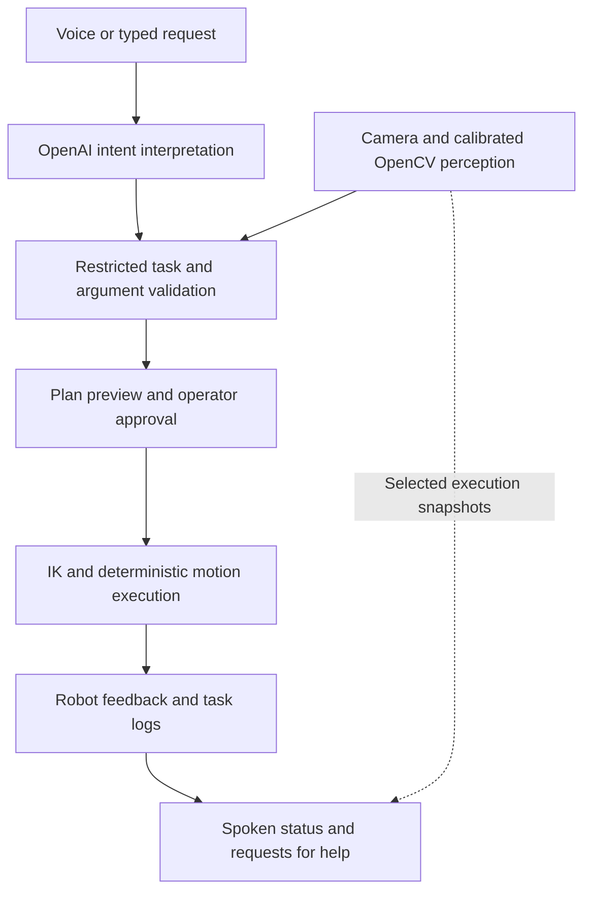

# KitRescue

**Talk to your cobot. Change the task, not the program.**

KitRescue is a voice-driven interface for a real robot arm. Describe a task, review the grounded plan, and approve its execution. The robot locates coloured cubes, performs pick-and-place or ordered stacking, and explains its progress and failures.

Built for the **Physical AI Hack, London — 17 October 2026**.

## The problem

Collaborative robots can execute repeatable tasks, but changing those tasks often requires programming expertise or navigating a teach pendant. Operators know the outcome they want; translating that intent into robot instructions is the barrier.

KitRescue explores an alternative: an agentic task interface that connects natural language to a small, explicit set of robot capabilities. An LLM interprets intent; calibrated vision supplies positions; a deterministic controller executes the approved task.

## What it does

- Locates **orange, grey and black 30 mm cubes** using colour and top-face geometry.
- Stacks two or three separate cubes in a requested bottom-to-top order.
- Transfers a cube to a robot XY destination, or requests a relative X/Y displacement through the voice interface.
- Offers an inset workspace-edge destination through the voice interface.
- Shows live camera video, candidate boxes, top-face proposals and task progress.
- Provides spoken replies and occasional image-based execution commentary.
- Retries failed detection once during voice-task planning; asks for help when checks fail.

Example requests:

> “Stack orange on grey.”
>
> “Stack grey, orange, black, bottom to top.”
>
> “Move orange five millimetres in positive X.”
>
> “Move black to the maximum-Y workspace edge.”

Offsets use **robot axes**, not image left/right. “Edge” means **30 mm inside the calibrated workspace boundary**, not the physical table edge. Commanded displacement is subject to calibration and servo tracking error.

## Architecture



The LLM does not generate joint commands. Execution commentary cannot change the route or trigger recovery. This prototype uses explicit perception and control rather than a trained vision-language-action policy.

## Hardware and software

| Component | Role |
|---|---|
| Hiwonder NexArm follower arm | Physical manipulation |
| Logitech C920 webcam | Static workspace camera |
| LattePanda running Ubuntu | Camera, perception, control and web server |
| OpenCV / NumPy | Colour segmentation, edge geometry and coordinate mapping |
| Vendor SDK / application transport | IK, servo communication and feedback |
| OpenAI Responses API | Strict function calling for task interpretation |
| GPT-4o mini Transcribe | Voice input |
| GPT-4o mini TTS | Kit’s generated voice |
| GPT-4.1 mini | Task interpretation and selected snapshot descriptions |
| FastAPI / Uvicorn | Browser interface |
| FFmpeg | Browser-audio conversion to WAV |

Camera processing and robot control run locally. Speech and language/vision API calls require an internet connection and OpenAI API credits. Idle video does not make OpenAI API calls.

## Setup

Run these commands on the computer connected to the robot and camera:

```bash
sudo apt install -y python3-venv v4l-utils ffmpeg psmisc

python3 -m venv ~/nexarm-venv
source ~/nexarm-venv/bin/activate

python -m pip install \
  numpy opencv-contrib-python pyserial \
  openai fastapi uvicorn python-multipart
```

Use this repository’s NexArm vendor dependency at `vendor/NexArm`. Robot and camera access require the appropriate Linux device permissions.

Identify devices:

```bash
ls -l /dev/serial/by-id/
ls -l /dev/v4l/by-id/
```

Use stable device paths. Camera configuration lives in `config/camera.json`; robot commands accept `--port` where exposed. Confirm the port points to the robot before sending movement commands.

Export your API key in the terminal that launches the interface:

```bash
read -rsp "OpenAI API key: " OPENAI_API_KEY
echo
export OPENAI_API_KEY
```

Never commit API keys. `OPENAI_MODEL` optionally selects the interpretation model; `KIT_VOICE` optionally selects the TTS voice, with `marin` as the default.

## Calibration

### Camera settings

Fix the camera mount, resolution, orientation and focus. Set exposure, gain and white balance for the venue, then keep them consistent while learning colours and operating the robot.

```bash
python src/kitrescue/camera.py capture \
  --config config/camera.json \
  --output data/camera/venue.jpg
```

The capture command saves a raw image, a processed image and camera metadata.

### Colour sampling

Use the browser sampler to mark the workspace and representative top-face patches for each colour. Include normal brightness variation without including the background, borders or cast shadows.

```bash
python src/kitrescue/cubes.py learn \
  --image data/camera/venue_processed.png \
  --samples config/colour_samples.json \
  --profile config/cube_colours.json \
  --resample \
  --min-area 900
```

Check the learned candidates:

```bash
python src/kitrescue/cubes.py check \
  --image data/camera/venue_processed.png \
  --profile config/cube_colours.json \
  --min-area 900 \
  --expect orange=1 --expect grey=1 --expect black=1
```

A colour candidate is not yet a verified grasp pose. Top-face detection adds edge and known-size evidence.

### Robot–camera alignment

A **30 mm ArUco calibration cube**, with top marker **ID 5** from `DICT_4X4_50`, is aligned at known robot XY positions. The arm retracts clear of the camera, and the corresponding marker centre is recorded in image pixels.

These correspondences fit a **planar homography** from pixels to commanded robot XY on the cube-top plane. Held-out points, when collected, measure mapping error. Calibration is saved in `config/robot_camera.json`.

```bash
python src/kitrescue/calibrate.py --help
```

Choose calibration ranges and travel heights for the actual setup; the guided routine moves the robot. Saved calibration and grasp heights are setup-specific, not universal robot defaults.

Recalibrate geometry if the camera, robot base, support surface, image orientation or optical zoom changes. Display-only browser zoom does not change the mapping. Lighting changes usually require checking camera controls and colour samples.

## Run the voice interface

Close other processes using the webcam first. Start with an empty gripper and the robot at the taught `camera_clear` pose.

```bash
source ~/nexarm-venv/bin/activate
python src/kitrescue/voice_ui.py
```

Open **http://localhost:8787**. For a remote LattePanda, forward port **8787** through VS Code or SSH and open it in the laptop’s external browser. Microphone access needs a browser-supported secure context, such as forwarded localhost.

1. Enable Kit’s voice and inspect the live detections.
2. Type a request, or record and verify its transcription.
3. Select **Plan task**.
4. Check the colours, destination and bottom-to-top order.
5. Clear hands and routes, then select **Execute once**.

For three cubes, the first cube remains as the base: **three cubes require two transfers**. Start with the cubes separate on the table. Picking from an existing stack is outside the supported voice workflow.

**Look at workspace** analyses a fresh snapshot and cancels any unexecuted plan. Plans expire after two minutes.

The live stream continues during tasks; preview detection pauses while jobs are active. Execution commentary uses up to four selected frames and does not steer motion.

## Direct task commands

Calculate a two-cube stack without task movement:

```bash
python src/kitrescue/manipulation.py stack grey orange \
  --allow-unvalidated --preview-zoom 1.0 --fast
```

Execute three-cube stacking, bottom to top:

```bash
python src/kitrescue/manipulation.py stack grey orange black \
  --allow-unvalidated --preview-zoom 1.0 \
  --fast --execute --one-confirm
```

Transfer orange to a table-plane robot XY destination:

```bash
python src/kitrescue/manipulation.py transfer orange \
  --to 180 0 --allow-unvalidated \
  --preview-zoom 1.0 --fast --execute --one-confirm
```

Destinations must be appropriate for the current calibration and clear of other objects. `--fast` selects the faster motion profile; omit it for the regular profile.

`--allow-unvalidated` explicitly permits a supervised trial with calibration that has not passed its acceptance checks. It does not improve accuracy or validate extrapolation. The voice prototype currently enables this trial setting and discloses it in the UI.

## Failure handling and shutdown

Detection failures receive one planning retry without robot movement. Motion-check failures stop further commands and request operator assistance; tasks are not automatically replayed.

Use **Stop & exit app** or **Ctrl+C** for normal shutdown. New joint commands are blocked, the current command may finish, and resources are closed. Shutdown does not park, release an object or remove motor power. It is not an emergency stop.

If the webcam is busy:

```bash
fuser -v /dev/video0
```

Identify the owning process before stopping it. Run only one camera-owning application.

## Logs

- `data/manipulation/latest_run.log` — command, feedback and execution trace.
- `data/manipulation/plan.json` — interpreted robot task and planned transfers.
- `data/manipulation/last_motion_failure.json` — most recent recorded motion failure; may belong to an earlier run.
- `data/voice/events.jsonl` — interface job outcomes.
- `data/voice/commentary.jsonl` — visual commentary and frame references.
- `data/voice/frames/` — selected execution snapshots.

Inspect timestamps when diagnosing failures. Keep secrets and unnecessary captured images out of the public repository.

## Current scope

This is a supervised hackathon prototype, not a production or safety-certified cobot controller. It assumes known 30 mm cubes, a fixed camera, a calibrated table plane and an operator-cleared workspace. It does not provide general 3D reconstruction, continuous visual servoing, geometric collision avoidance or automatic verification of every grasp.

Table pick-and-place and ordered stacking are the demo scope. Tray interaction remains experimental and is excluded from the current voice tools.

## Acknowledgements

Built by **Pranav Shirgur** for the Physical AI Hack hosted by Reasoning Project with microagi, powered by OpenAI and ElevenLabs.

The implementation uses OpenAI APIs, OpenCV, and Hiwonder’s NexArm SDK. Vendor components retain their respective licences and attribution requirements.


